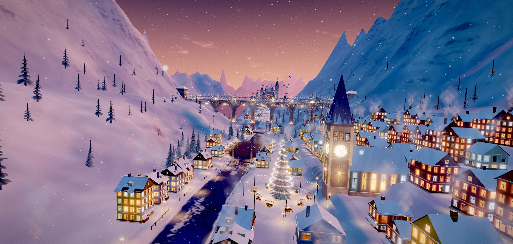

# Endless Worlds and Portals

An endless, hands-off flight through 504 procedural 3D worlds in the browser. Each world ends in a portal. The portal opens on the next world, and the flight continues.

**Live site: <https://az9713.github.io/endless-worlds-and-portals/>** (click the picture above to open it)

Press **S** for sound. The site is a static web page. Your browser draws every world, so nothing streams from a server and no video file is involved.

## What a visit looks like

- The flight starts by itself. No input is needed.
- Each visit receives a new random session number (`src/core/engine.js:120`). The order of the worlds therefore differs from visit to visit.
- Worlds you have not seen come first. The first dozen worlds of a visit favour worlds that the judging agents rated best. The **Earthly to Strange** slider sets how often strange worlds appear.
- Fixed journeys fly a set of worlds in a set order, for example `?suite=beyond-media`.
- Everything is generated by code: geometry, textures, shaders and the gentle piano score. The site has no 3D model files, no image files for the worlds, and no audio files.

## Controls

| Key | Action |
|---|---|
| Space | Pause or resume |
| → | Skip ahead |
| E | Hold the path position and look around. Drag or swipe to look. |
| Home | Face forward again |
| I | Open the gallery of worlds |
| S | Sound on or off |
| F | Fullscreen |
| C | Switch between steady and sweeping camera |
| P | Take a photo |
| O | More options |

## What is in this repository

| Path | Content |
|---|---|
| `docs/` | The built site that GitHub Pages serves. It has 504 registered worlds. Build stamp: `beyond-clock-galleries-1`. |
| `LICENSE` | CC BY-NC-SA 4.0 licence text |
| `THIRD-PARTY-NOTICES.txt` | Credits for three.js and other open-source work |

To run the site on your own machine, serve `docs/` with any static file server, for example `python -m http.server` inside `docs/`. Opening `index.html` as a `file://` page does not work, because the app loads ES modules.

## Origin and licence

This is a derivative of [Portals by Ethan Mollick (`emollick/ai-portals`)](https://github.com/emollick/ai-portals), taken at commit `210133f4e718acb7b461f2a40c90661a40a2397f`. That commit had 471 worlds. This site has 504: the 471 inherited worlds plus 33 new original worlds.

Changes from the upstream project:

- 33 new original worlds. They include a Wonderland garden, a ribbon town, a cloud port and a clockwork city.
- A code-generated piano score replaces the upstream audio. The score plays on without a break across portals.
- Manual exploration: the E key and drag-to-look-around.

Sixteen unfinished original worlds are not part of this site.

The work is licensed under [CC BY-NC-SA 4.0](LICENSE). Credit the original Portals project and Ethan Mollick when you reuse it. Use it for non-commercial purposes only. Share changes under the same licence.

## Known limits

- The site needs a browser with WebGL and a capable GPU.
- Tested on desktop Chrome only. A phone test is not done.
- Earlier versions of this repository held an MP4 showcase of 97 video parts. The live flight replaces it. The MP4 files remain in this repository's Git history but not in the current files.
